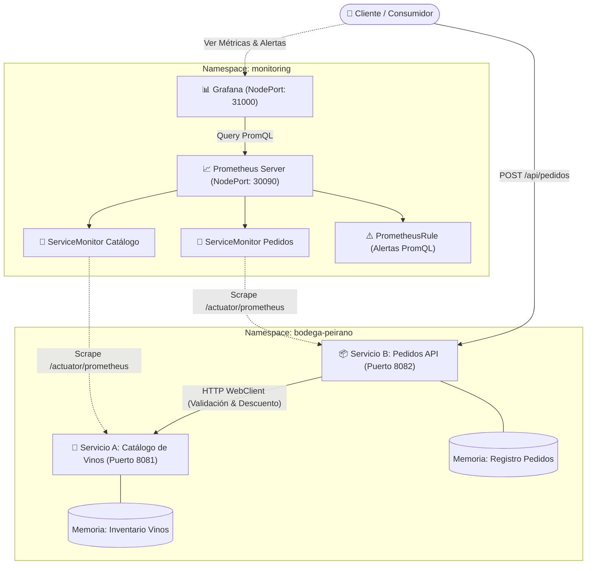

# 🍷 Bodega Peirano — Microservicios en Kubernetes con Monitoreo Prometheus & Grafana

Proyecto integral de arquitectura de microservicios contenerizados y desplegados en **Kubernetes (Minikube)**, instrumentados con **Micrometer**, monitoreados mediante **Prometheus Operator (kube-prometheus-stack)** y visualizados a través de **Grafana**.

---

## 📋 1. Dominio de Negocio: Bodega Peirano

**Bodega Peirano** es una bodega vitivinícola y tienda de vinos de alta gama. Su arquitectura digital desacopla la gestión del catálogo de vinos y el procesamiento de pedidos de clientes en dos microservicios autónomos:

* **Servicio A — Catálogo de Vinos (`catalogo-service`):** Expone el inventario de vinos finos (nombre, bodega, varietal, cosecha, precio y stock disponible).
* **Servicio B — API de Pedidos (`pedidos-service`):** Recibe las órdenes de compra de restaurantes, hoteles y particulares. Para procesar cada orden, consulta de forma síncrona vía **HTTP (Spring WebClient)** al Servicio A para validar existencia y disponibilidad de stock. Si la validación es satisfactoria, descuenta el stock en el Servicio A y aprueba el pedido; caso contrario, lo rechaza.

> [!IMPORTANT]
> **Interdependencia de Microservicios:** El Servicio B depende estrictamente de la respuesta del Servicio A para tomar la decisión de negocio (aprobar o rechazar). Sin esta comunicación HTTP activa no existe arquitectura distribuida real.

---

## 🏛️ 2. Diagrama de Arquitectura



---

## 📊 3. Matriz de Cumplimiento de la Rúbrica (20 / 20 Puntos)

| Criterio | Puntos | Implementación en Bodega Peirano | Estado |
| :--- | :---: | :--- | :---: |
| **Microservicios Java** | **5 pts** | • Java 17 / Spring Boot 3.3.4 + Maven<br>• Spring WebClient reactivo para comunicación HTTP<br>• Health Check (`/actuator/health/liveness` y `readiness`)<br>• Endpoint de métricas en `/metrics` y `/actuator/prometheus`<br>• Mínimo 4 endpoints de negocio por servicio (7 en Catálogo, 6 en Pedidos)<br>• Micrometer con Counter, Gauge y Timer (mínimo 4 por servicio)<br>• Almacenamiento en memoria concurrente (`ConcurrentHashMap`)<br>• Dockerfile en dos etapas (`builder` + `alpine runtime`) | ✅ **Cumplido** |
| **Cluster desde cero** | **5 pts** | • Docker Desktop, Minikube, kubectl y Helm verificados<br>• Addon `metrics-server` habilitado en Minikube<br>• Stack `kube-prometheus-stack` instalado con Helm<br>• Grafana (NodePort 31000) y Prometheus (NodePort 30090)<br>• `serviceMonitorSelectorNilUsesHelmValues: false` para descubrir monitores en todos los namespaces<br>• Contraseña personalizada de Grafana (`bodega-peirano-2026`) | ✅ **Cumplido** |
| **Despliegue** | **4 pts** | • Namespace propio `bodega-peirano`<br>• Deployments con Probes Liveness y Readiness<br>• Límites y peticiones de CPU / Memoria configurados<br>• `imagePullPolicy: IfNotPresent`<br>• Services tipo NodePort con puerto nombrado **`http`** | ✅ **Cumplido** |
| **Monitoreo** | **3 pts** | • `ServiceMonitor` dedicado para cada servicio con puerto `http`<br>• Alertas PromQL de servicio caído y reglas de negocio<br>• Dashboard de Grafana con 8 paneles ricos exportado en JSON | ✅ **Cumplido** |
| **Casuísticas** | **3 pts** | • **Servicio Caído:** Simulación de caída del Servicio A y fallback en B<br>• **Servicio Lento:** Demora inducida (`/simular-demora`) y percentil p95<br>• **Regla de Negocio:** Agotamiento de stock y alta tasa de rechazos | ✅ **Cumplido** |
| **Scripts** | **1 pt** | • `setup.sh` / `setup.ps1`<br>• `teardown.sh` / `teardown.ps1`<br>• `load-testing/stress.sh` / `stress.ps1` | ✅ **Cumplido** |

---

## 🔬 4. Métricas Micrometer Implementadas

### Servicio A — Catálogo de Vinos (`catalogo-service`)
1. **Counter:** `bodega_catalogo_consultas_total` (tags: `resultado="ok"|"no_encontrado"`): Conteo de consultas al catálogo.
2. **Counter:** `bodega_catalogo_stock_descontado_total`: Unidades acumuladas de botellas vendidas/descontadas.
3. **Gauge:** `bodega_catalogo_stock_total`: Cantidad total de botellas en inventario en tiempo real.
4. **Gauge:** `bodega_catalogo_vinos_activos`: Número de etiquetas o variedades de vino comercializadas.
5. **Timer:** `bodega_catalogo_consulta_duracion_seconds`: Medición de latencia de búsquedas y consultas.

### Servicio B — API de Pedidos (`pedidos-service`)
1. **Counter:** `bodega_pedidos_creados_total` (tags: `estado="aprobado"|"rechazado"|"fallido"`, `motivo`): Total de pedidos procesados.
2. **Counter:** `bodega_pedidos_ingresos_total`: Ingresos monetarios acumulados en Soles (PEN).
3. **Gauge:** `bodega_pedidos_activos_total`: Total de pedidos almacenados en el sistema.
4. **Gauge:** `bodega_pedidos_tasa_rechazo`: Porcentaje dinámico de pedidos rechazados vs totales.
5. **Timer:** `bodega_pedidos_procesamiento_duracion_seconds`: Latencia de llamada HTTP al Servicio A y procesamiento del pedido.

---

## 🚀 5. Guía de Ejecución Rápida

### Opción A: Despliegue en Windows (PowerShell)
```powershell
# Ejecutar script de despliegue automatizado
.\scripts\setup.ps1
```

### Opción B: Despliegue en Linux / macOS / Git Bash
```bash
chmod +x scripts/*.sh scripts/load-testing/*.sh
./scripts/setup.sh
```

El script se encargará automáticamente de:
1. Validar las herramientas instaladas (`docker`, `minikube`, `kubectl`, `helm`, `mvn`).
2. Iniciar Minikube y activar el addon `metrics-server`.
3. Instalar `kube-prometheus-stack` con las configuraciones requeridas.
4. Configurar el demonio Docker de Minikube y compilar las imágenes en dos etapas.
5. Aplicar los manifiestos de Kubernetes en el namespace `bodega-peirano`.
6. Esperar a que los pods alcancen el estado `Ready`.

---

## 🌐 6. Acceso a los Servicios y Credenciales

Obtenga la IP de Minikube ejecutando: `minikube ip` (ejemplo: `192.168.49.2`).

| Servicio | URL / Endpoint | Credenciales / Puerto |
| :--- | :--- | :--- |
| **Servicio A (Catálogo)** | `http://<MINIKUBE_IP>:30081/api/vinos` | Puerto NodePort 30081 |
| **Catálogo Health** | `http://<MINIKUBE_IP>:30081/actuator/health` | Probes Liveness & Readiness |
| **Catálogo Métricas** | `http://<MINIKUBE_IP>:30081/metrics` | Formato Scrape Prometheus |
| **Servicio B (Pedidos)** | `http://<MINIKUBE_IP>:30082/api/pedidos` | Puerto NodePort 30082 |
| **Pedidos Health** | `http://<MINIKUBE_IP>:30082/actuator/health` | Probes Liveness & Readiness |
| **Pedidos Métricas** | `http://<MINIKUBE_IP>:30082/metrics` | Formato Scrape Prometheus |
| **Grafana** | `http://<MINIKUBE_IP>:31000` | Usuario: `admin`<br>Password: `bodega-peirano-2026` |
| **Prometheus** | `http://<MINIKUBE_IP>:30090` | Consola de PromQL & Alertas |

---

## 📈 7. Importación del Dashboard en Grafana

1. Ingrese a Grafana en `http://<MINIKUBE_IP>:31000` con el usuario `admin` y contraseña `bodega-peirano-2026`.
2. En el menú lateral izquierdo, vaya a **Dashboards** → **New** → **Import**.
3. Haga clic en **Upload JSON file** y seleccione el archivo:
   ```
   grafana/bodega-peirano-dashboard.json
   ```
4. Seleccione el Data Source **Prometheus** y haga clic en **Import**.
5. Tendrá a su disposición los **8 paneles interactivos**:
   - *Disponibilidad de Microservicios (UP/DOWN)*
   - *Tasa Actual de Rechazo de Pedidos (%)*
   - *Ingresos Acumulados de Ventas (PEN)*
   - *Stock Total Disponible en Bodega*
   - *Flujo de Pedidos por Segundo (Aprobados vs Rechazados)*
   - *Latencia de Procesamiento de Pedidos (Media vs p95)*
   - *Throughput de Consultas al Catálogo*
   - *Evolución Temporal del Inventario y Unidades Vendidas*

---

## 🧪 8. Validación de Casuísticas con el Generador de Carga

Ejecute el generador de carga interactivo:

```powershell
# En Windows PowerShell:
.\scripts\load-testing\stress.ps1

# En Linux / Mac / Git Bash:
./scripts/load-testing/stress.sh
```

### Casuística 1: Servicio Caído (Resiliencia)
* **Acción:** Seleccione la opción `4` en el menú interactivo (o ejecute `kubectl scale deployment catalogo-deployment -n bodega-peirano --replicas=0`).
* **Efecto Observado:**
  * El Servicio B detecta que el Servicio A no responde y maneja el fallo gracefully marcando el pedido como `FALLIDO` (HTTP 503).
  * En Prometheus se activa la alerta **`CatalogoServiceDown`**.
  * En Grafana el panel de *Disponibilidad* cambia a **DOWN** en rojo.
* **Restauración:** Seleccione la opción `5` (escala réplicas a 1). El panel regresa a **ONLINE** verde.

### Casuística 2: Servicio Lento (Rendimiento)
* **Acción:** Seleccione la opción `3` en el script (o invoque `GET /api/vinos/simular-demora?segundos=3`).
* **Efecto Observado:**
  * El Timer de Micrometer registra el incremento de latencia.
  * El panel de Grafana *Latencia de Procesamiento p95* muestra un pico pronunciado.
  * Se activa la alerta **`SlowOrderProcessingLatency`** en Prometheus.

### Casuística 3: Regla de Negocio Propia (Stock Agotado y Alta Tasa de Rechazos)
* **Acción:** Seleccione la opción `2` en el script (envía ráfagas de pedidos solicitando 500 botellas o vinos inexistentes).
* **Efecto Observado:**
  * El Servicio B consulta al Servicio A, comprueba que el stock es insuficiente o el vino no existe, y rechaza los pedidos con motivo detallado.
  * La métrica Gauge `bodega_pedidos_tasa_rechazo` sube por encima del 30%.
  * Se activan las alertas de negocio **`HighOrderRejectionRate`** y **`CriticalWineStockLevel`**.

---

## 🧹 9. Limpieza del Entorno

Para desinstalar la aplicación y liberar recursos del cluster:

```powershell
# En Windows PowerShell:
.\scripts\teardown.ps1

# En Linux / Mac / Git Bash:
./scripts/teardown.sh
```
